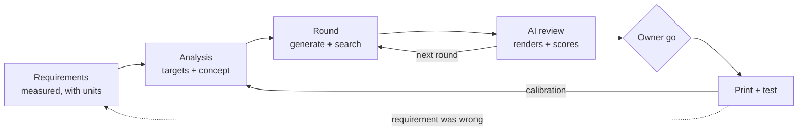

# gendesign

AI + generative design for physical parts, done in the order a mechanical engineer works: **requirements, then analysis, then the algorithm and the AI decide what the part should look like.** Nothing starts from a drawing, and nothing goes to a printer without the owner's go.



| Stage | Command | Writes | Who |
|---|---|---|---|
| Requirements | — | `models/<name>/requirements.yaml` | owner, measured |
| Analysis | `gendesign analyze models/<name>` | `analysis.md`, `analysis.json`: design targets, each traced to a requirement and an equation; concepts screened against them | code + AI |
| Round | `gendesign round models/<name>` | `designs/<d>/iterations/NN/`: `round.json`, `pareto.png`, `picks.png`, `picks/<pick>/`, `decisions.md` | code |
| Review | edit `decisions.md` | what the renders show that the scores miss; the next round | AI |
| Report | `gendesign report models/<name>` | `REPORT.md`: requirements, analysis, every round, tests | code |
| Go | `gendesign approve <iteration> <pick>` | `approval.json`, decision in `decisions.md` | **owner only** |
| Print files | `gendesign generate models/<name> <pick>` | STL + mesh check (watertight, one body, area over air) | code |
| Feedback | `gendesign feedback <test.md>` | `feedback.json`; the next `analyze` and `round` use the calibrations | owner + AI |

A round refuses to run without an analysis. A calibration from a print corrects an evaluator; it never edits `requirements.yaml`. Only a wrong requirement goes back to the owner. See [SKILL.md](SKILL.md) for the rules the agent follows and [docs/ARCHITECTURE.md](docs/ARCHITECTURE.md) for the interfaces.

## Example

The example is a model folder with `requirements.yaml`, `model.py`, `analysis.md`, and a `REPORT.md` you can review.

| Example | What the analysis decided | Report |
|---|---|---|
| [Hair catcher](models/hair-catcher/) | Drainage binds (408 mm² open for v2-level flow); structure has 1.29x margin. Flat plate chosen over cone and two-level. Round 01 knee (confirmed by a cold round 02): 11 holes 5.2–6.3 mm, 81 cm³/s, zero hair snag and corner water, nothing over air. Approved by the owner 2026-11-14; to be printed. | [REPORT.md](models/hair-catcher/REPORT.md) |


## Methods in the package

| Method | Status | Where |
|---|---|---|
| Loop: analyze, round, review record, approve, feedback, report, generate | implemented | [`gendesign/loop.py`](gendesign/loop.py) |
| Generator / Evaluator interfaces, seeded search, Pareto result | implemented | [`gendesign/process.py`](gendesign/process.py) |
| NSGA-II, grid, random, genetic, CMA-ES, Bayesian (Optuna TPE) | implemented | [`gendesign/search.py`](gendesign/search.py) |
| Implicit / signed-distance modeling: smooth Booleans, exact polygon fields, meshing, overhang check | implemented | [`gendesign/field.py`](gendesign/field.py) |
| 2-D and 3-D SIMP topology optimization (optimality criteria, density filter) | implemented, not yet a round generator | [`gendesign/topopt2d.py`](gendesign/topopt2d.py), [`topopt3d.py`](gendesign/topopt3d.py), `gendesign topopt2d` |
| Plane-stress FE peak stress, beam grillage | implemented | [`stress2d.py`](gendesign/stress2d.py), [`stiffness.py`](gendesign/stiffness.py) |
| Orifice drainage with a capillary film limit | implemented | [`gendesign/flow2d.py`](gendesign/flow2d.py) |
| Corner proxies: hair snag, corner water | implemented, not yet in the hair-catcher round | [`gendesign/corners.py`](gendesign/corners.py) |
| Voronoi and gyroid lattices | implemented | [`gendesign/lattice.py`](gendesign/lattice.py), `gendesign gyroid` |
| Printability: volume, min feature, overhang, optional PrusaSlicer | implemented | [`gendesign/evaluate.py`](gendesign/evaluate.py) |
| 3-D solid FEA, level-set, MMA, CFD, topology optimization inside a round | planned | [ROADMAP.md](ROADMAP.md) |

## Quick start

```bash
python -m venv .venv
.venv/bin/pip install -e ".[parts,dev]"
.venv/bin/gendesign analyze models/hair-catcher
.venv/bin/gendesign round models/hair-catcher --from models/hair-catcher/designs/pebble-plate/iterations/01
.venv/bin/gendesign report models/hair-catcher
.venv/bin/python -m pytest
```

Start a new part with `gendesign new models/<name>`, fill `requirements.yaml` with measured numbers, then write `analyze()` before the generator.

## Layout

```
gendesign/            the package: loop, process, search, field, solvers, evaluators
models/<name>/        an example: requirements.yaml, model.py, analysis.md, REPORT.md, designs/
models/<name>/archive/  scripts that produced earlier designs, kept so the records can be re-run
templates/model/      starter for gendesign new
tests/                pytest
```

## Design rules

Function first; looks still matter, but a shape preference must come from a functional score, not be typed in. Flat face on the bed, no supports unless the model says so, no flat ledge over air. 100% infill on small parts. Never start a print without the owner's go.

## License

Code is MIT ([LICENSE](LICENSE)). Generated models and images are [CC BY 4.0](https://creativecommons.org/licenses/by/4.0/).
