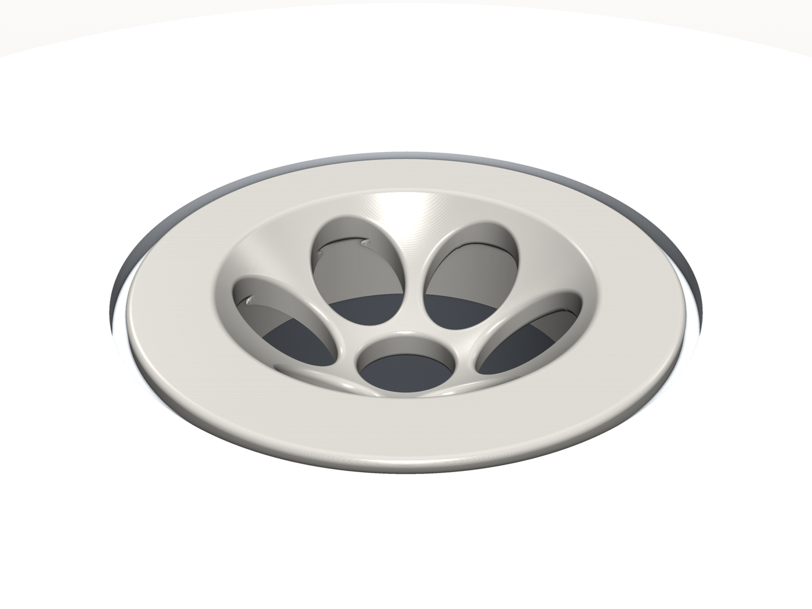
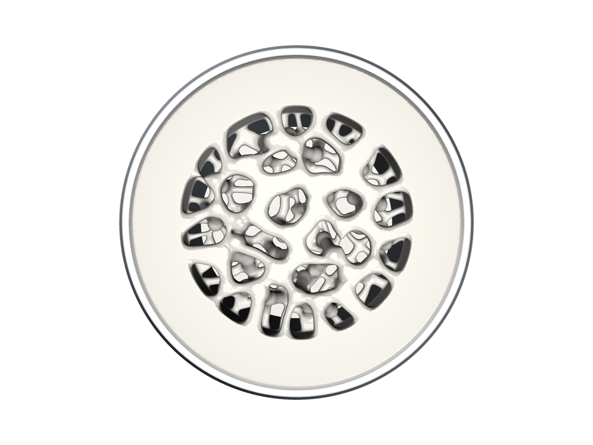
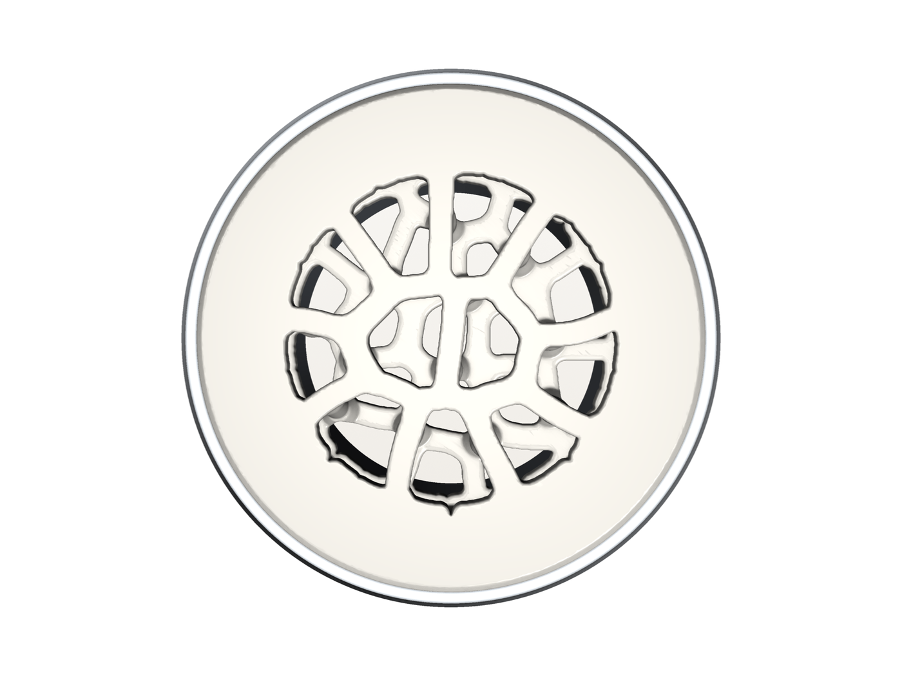
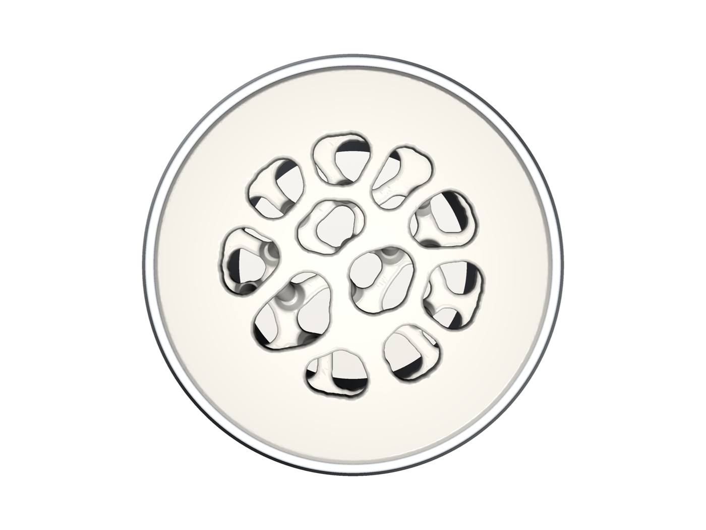
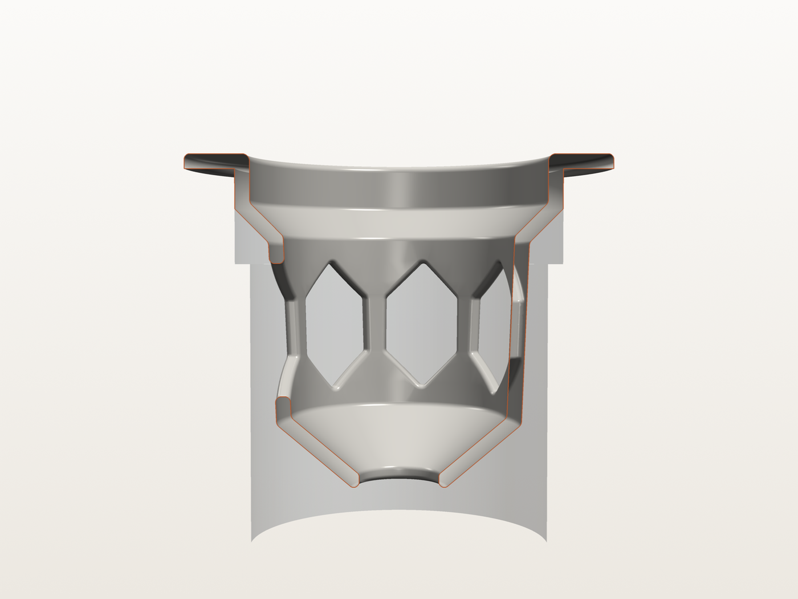
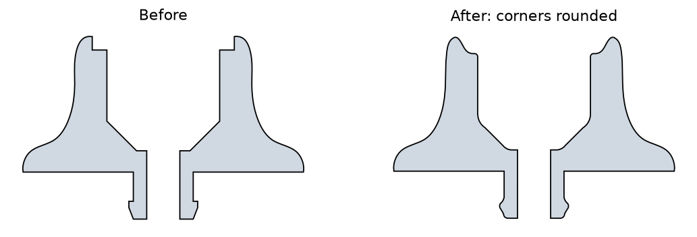
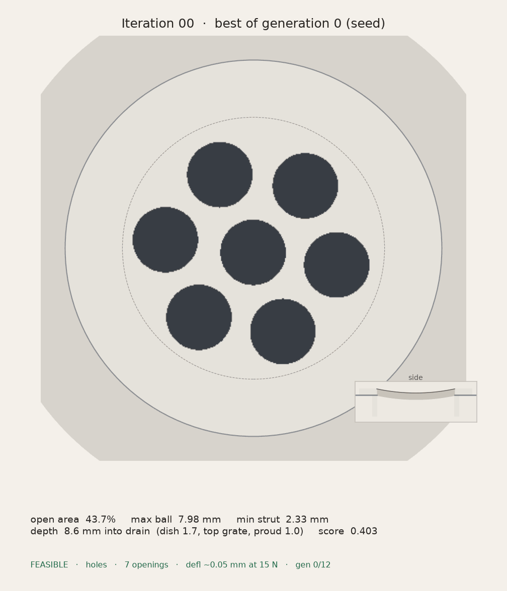
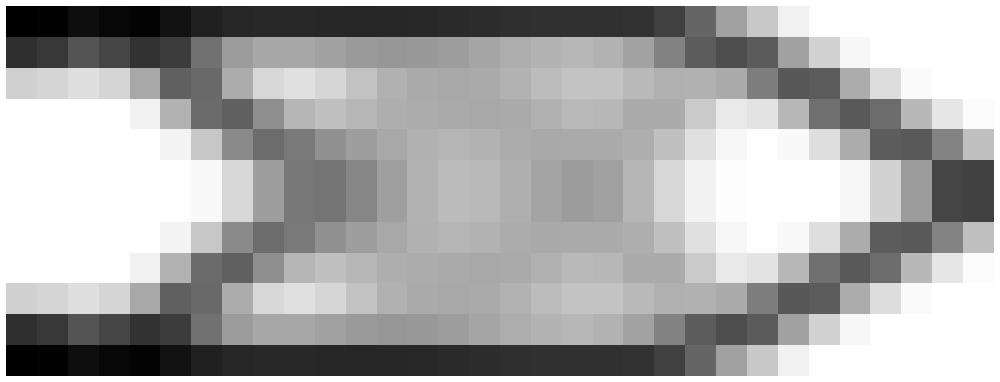
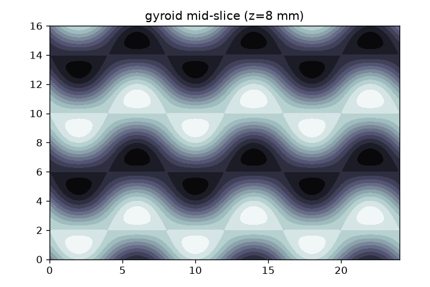

# gendesign

AI + generative design for parts that have to work in the real world. The AI agent reviews, reasons, and redirects. The code computes and searches. They share one loop: requirements, analysis, a method you can rerun, a printability check, a print only when the owner says go, then a measurement that drives the next design.

The `gendesign` package is the toolkit (topology optimization, lattices, search, smoothing, evaluation). The parts under `models/` are worked examples of that loop: a basin hair catcher and a drybox adapter. A saved `design.json` rebuilds the geometry. The bench is what finishes the job.

**Nothing in this repo starts a print on its own.** Read [SKILL.md](SKILL.md) for the loop. Read `models/<name>/SKILL.md` before changing an example. Planned solvers are in [ROADMAP.md](ROADMAP.md).

## How this differs from text-to-CAD

| | gendesign | A text-to-CAD prompt |
|---|---|---|
| Input | Requirements with units, and the load, flow, or fit that decides the part | A description of the object |
| Geometry | A named method you can rerun: SIMP, a lattice, a parametric search | A mesh inferred from the prompt |
| Record | `design.json`, iteration renders, a one-line critique | The file that came back |
| Finished | A physical part has been measured and written up in `test.md` | The file looks right |

The agent reads the skill, picks a method, and edits code. The method stays inspectable. A prompt that emits a mesh is a different tool.

## Loop

1. Requirements, with units. Do not invent a fit-critical dimension.
2. Analysis: loads, flow, or fit — whichever actually decides the part.
3. Generate or optimize. Save the winner as `models/<name>/designs/<design>/design.json`.
4. Printability and a slice estimate. Re-slice for a real time.
5. Print only after the owner's go.
6. Physical test. Measure and photograph.
7. Write `test.md` and feed that result into the next design.

## Methods

| Method | Status | Where |
|---|---|---|
| 2-D SIMP, optimality criteria, density filter | implemented | [`gendesign/topopt2d.py`](gendesign/topopt2d.py), [`examples/topopt_bracket`](examples/topopt_bracket/), `gendesign topopt2d` |
| 3-D voxel SIMP | implemented | [`gendesign/topopt3d.py`](gendesign/topopt3d.py), `gendesign topopt3d` |
| Plate SIMP on the hair-catcher grate | implemented | [`models/hair-catcher/methods/topopt_plate.py`](models/hair-catcher/methods/topopt_plate.py) |
| Level-set topology optimization | planned | [ROADMAP.md](ROADMAP.md) |
| MMA (method of moving asymptotes) | planned | [ROADMAP.md](ROADMAP.md) |
| Grid, random, genetic algorithm, CMA-ES, NSGA-II | implemented | [`gendesign/search.py`](gendesign/search.py) |
| 2-D orifice drainage estimate | implemented | [`gendesign/flow2d.py`](gendesign/flow2d.py) |
| Beam-grillage stiffness | implemented | [`gendesign/stiffness.py`](gendesign/stiffness.py) |
| Bayesian search (Optuna TPE) | implemented, optional | `bayesian_search` in `search.py` (falls back to CMA-ES if Optuna is absent; `pip install -e ".[bayes]"`) |
| Parametric search on a part | implemented | hair-catcher bowl search, drybox pocket sweep |
| Hair-catcher generative rounds | in progress | [`models/hair-catcher`](models/hair-catcher/) — AI reviews each round; code searches |
| General shape / size optimization | planned | [ROADMAP.md](ROADMAP.md) |
| Voronoi lattices | implemented | `voronoi_lattice` in [`gendesign/lattice.py`](gendesign/lattice.py); hair-catcher A/B/C |
| TPMS gyroid | implemented | `gendesign gyroid`, [`examples/gyroid_shell`](examples/gyroid_shell/) |
| Smoothing (Laplacian, Taubin, CAD fillets) | implemented | [`gendesign/smooth.py`](gendesign/smooth.py), smooth v2 |
| Implicit / field modeling (shared library) | planned | version C is a one-off script in [`legacy-C/`](models/hair-catcher/legacy-C/) |
| Graph / rule-based generation | planned | [ROADMAP.md](ROADMAP.md) |
| Printability: volume, min feature, overhang, optional PrusaSlicer | implemented | [`gendesign/evaluate.py`](gendesign/evaluate.py) |
| Multi-physics checks | planned | [ROADMAP.md](ROADMAP.md) |
| Iteration log: contact sheet, gif, score chart | implemented | `gendesign iterate` |

Slice numbers in the examples are stand-ins unless the note names Bambu Studio, OrcaSlicer, or PrusaSlicer. Re-slice for a real time.

## Quick start

```bash
python -m venv .venv
.venv/bin/pip install -e .
.venv/bin/gendesign --help
.venv/bin/gendesign topopt2d --quick --out out/topopt2d
.venv/bin/gendesign gyroid --out out/gyroid.stl
.venv/bin/python examples/topopt_bracket/run.py --quick
.venv/bin/python examples/gyroid_shell/run.py
```

`python -m gendesign` is the same entry point. The worked examples need CadQuery, and version C also needs PyVista. `requirements.txt` is that full pin list (`pip install -e ".[parts]"` is the same extra set):

```bash
.venv/bin/pip install -r requirements.txt
.venv/bin/python models/hair-catcher/generate.py       # smooth v2 STL + STEP + stats
.venv/bin/python models/drybox-adapter/generate.py     # v9, P=8.85
.venv/bin/python generate_all.py                       # both defaults into out/
.venv/bin/python models/hair-catcher/optimize.py --method smooth --quick
.venv/bin/python models/drybox-adapter/optimize.py --quick
```

Version C (`search.py`, `build.py`, `render.py`) runs from [`models/hair-catcher/legacy-C/`](models/hair-catcher/legacy-C/).

## Layout

```
SKILL.md                 loop, rules, iteration record
ROADMAP.md               planned methods
pyproject.toml           pip install -e .  →  gendesign CLI
requirements.txt         full pin list, including CadQuery and version C
gendesign/               SIMP, lattices, search, smoothing, evaluation, iteration logs
examples/                runnable topopt bracket and gyroid
models/<name>/           worked example: SKILL, requirements, generate, optimize, designs/, docs/
models/hair-catcher/legacy-C/   original version C (scripts, metrics, preview)
templates/model/         starter for a new part
```

## Examples

Worked parts:

| | | |
|---|---|---|
| [Hair catcher, smooth v2](models/hair-catcher/) | [](models/hair-catcher/) | Default 7-hole bowl. Hair and water pass; an 8.6 mm ball does not. |
| [Voronoi A](models/hair-catcher/designs/voronoi-a/) | [](models/hair-catcher/docs/preview-voronoi-a-top.png) | Printed 2026-11-12. Small cells held water. |
| [Voronoi B](models/hair-catcher/designs/voronoi-b/) | [](models/hair-catcher/docs/preview-voronoi-b-top.png) | Larger cells, the drainage revision of A. |
| [Voronoi C](models/hair-catcher/legacy-C/) | [](models/hair-catcher/legacy-C/) | Rounded pebble cells. [Four views](models/hair-catcher/legacy-C/version-C.png). No bench test yet. |
| [Deep v3](models/hair-catcher/designs/deep-v3/) | [](models/hair-catcher/docs/comparison-v2-vs-v3-deep.png) | Experimental deep basket. |
| [Drybox adapter v9](models/drybox-adapter/) | [](models/drybox-adapter/) | PTFE pocket, default P = 8.85 mm. Printed holes run ~0.1–0.2 mm undersize. |

Search record for smooth v2, and the two method demos:



| | |
|---|---|
| [2-D SIMP cantilever](examples/topopt_bracket/) | [](examples/topopt_bracket/) |
| [Gyroid block](examples/gyroid_shell/) | [](examples/gyroid_shell/) |

## Physical test

A CAD file is a step. After a print the owner asked for, write `test.md` next to the design (or in that iteration folder):

- printed?
- settings
- measured dimensions vs designed
- fit / function
- photos
- failure notes
- next change

Known records: [`models/hair-catcher/designs/voronoi-a/test.md`](models/hair-catcher/designs/voronoi-a/test.md) (water hung in the fine cells; that print is why B exists) and [`models/drybox-adapter/designs/v9-8.85/test.md`](models/drybox-adapter/designs/v9-8.85/test.md) (pocket drawn at the pin size was too tight). Version C and smooth v2 have no recorded bench test. Leave a missing caliper reading blank.

## Add a method or an example

**A method.** Put the solver in `gendesign/` so another part can call it. If it should be a command, add a subcommand in `gendesign/__main__.py`. Add `examples/<name>/run.py` and a preview under `examples/<name>/docs/`. Mark it implemented in the table above, and take it off [ROADMAP.md](ROADMAP.md) once it runs.

**A worked example.** Copy [`templates/model/`](templates/model/) to `models/<name>/`. Fill `requirements.yaml` with measured numbers. `generate.py` rebuilds the saved design; `optimize.py` searches. Write `SKILL.md` with what the bench already taught. Save the winner as `designs/<design>/design.json`, with renders and a one-line critique per iteration. After a print, add `test.md`.

Design rules for either one: function first, looks still matter; no flat internal floors or ledges over air (45° cones or chamfers); flat face on the bed; no supports unless the model says so; 100% infill on small parts; never start a print without the owner's go.

## License

Code is MIT ([LICENSE](LICENSE)). Generated models and images are [CC BY 4.0](https://creativecommons.org/licenses/by/4.0/).
