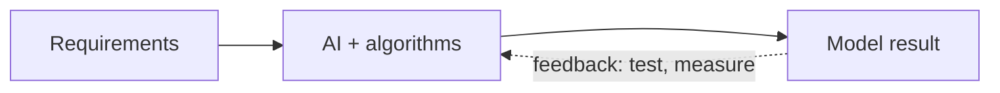

# gendesign

Requirements are the input. AI + algorithms are the process. A model is the output. Feedback from a test, a measurement, or a review goes back into the process. It does not rewrite the requirements.



A saved `design.json` rebuilds the geometry. `models/hair-catcher` and `models/drybox-adapter` are worked examples. Methods live in the `gendesign` package. Planned methods are in [ROADMAP.md](ROADMAP.md).

## Loop

Requirements, with units. Do not invent a fit-critical dimension. The process analyzes, generates, and checks printability. Save the result as `designs/<name>/design.json`. Print only after the owner's go. After a print, write `test.md`. That note is the next pass of the process, not a change to the requirements.

## Design rules

- No flat internal floors or ledges over air. Use 45° cones or chamfers.
- Flat face on the bed. No supports unless that model says so.
- 100% infill on small parts.
- Never start a print without the owner's go.
- Each iteration: renders plus a one-line critique. After a print, a `test.md`.

## Iteration record

```
models/<name>/designs/<design>/design.json
models/<name>/designs/<design>/iterations/NN/
    params.json  stats.json  critique.md  preview.png  test.md
```

`test.md`: printed?, settings, measured dims vs designed, fit/function, photos, failure notes, next change.
A design-level `test.md` is fine when the print is not one search round.
Known records: `models/hair-catcher/designs/voronoi-a/test.md`,
`models/drybox-adapter/designs/v9-8.85/test.md`.

## Commands

```bash
pip install -e .
pip install -r requirements.txt
gendesign topopt2d --quick --out out/topopt2d
python models/hair-catcher/generate.py
python models/drybox-adapter/generate.py
python examples/gyroid_shell/run.py
```

`python -m gendesign` is the same CLI. Version C scripts run from `models/hair-catcher/legacy-C/`. CadQuery generates the guard and the adapter; the `gendesign` commands do not need it.
