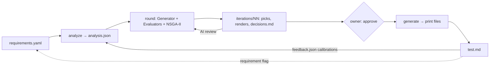

# Architecture

Requirements are measured input. Analysis turns them into targets and picks a concept. Generators and search make candidates inside those targets. The AI reviews; the owner approves; a test corrects the evaluators. A wrong requirement is a separate, rarer path.

## Interfaces

| Piece | Role | Where |
|---|---|---|
| `Requirements` | Loads `requirements.yaml`, checks the schema. Carries `calibrations` (from every `feedback.json`) and `analysis` (targets) into a round. `calibrated(key, default)` is how an evaluator reads a corrected setting. | `gendesign/requirements.py` |
| `MODEL` | One object per `models/<name>/model.py`: `analyze(req)`, `generator(req)`, `evaluators(req)`, `export(design, out)`, `preview(design, png)`, `default_design`. | each model |
| analysis | `{targets: {name: {value, from, how}}, checks, concepts: [{name, verdict, why}], chosen, generator, open_questions}` | `gendesign/loop.py: analyze` |
| `Generator` | `bounds()`, `generate(x, req)`, and `x_from_params(params)` so a saved pick can be rebuilt. | `gendesign/process.py` |
| `Evaluator` | `evaluate(design, req)` returns objectives (maximized; names in `objectives`), a constraint violation, metrics, uncertainties. | `gendesign/process.py` |
| Search | Seeded `run()`; NSGA-II by default. The config and per-generation history are part of the result. | `gendesign/process.py`, `gendesign/search.py` |
| Round | Picks the knee plus the best design per objective, renders, exports with a mesh check, writes `decisions.md` with review sections left for the AI. | `gendesign/loop.py: run_round` |
| Field | Smooth Booleans, exact polygon fields, marching cubes to a watertight mesh, print orientation, area printed over air. | `gendesign/field.py` |
| Feedback | `calibrate:` and `requirement:` lines in a `test.md` → `feedback.json`. | `gendesign/loop.py: parse_feedback` |
| Report | `REPORT.md` per model from the files above. | `gendesign/loop.py: report` |

A model supplies one analysis, one generator per concept, and its evaluators. It does not grow a second search loop. Scripts that produced earlier designs live in `models/<name>/archive/` as records.

## What a round records

Seed, method, population, generations, generator and evaluator names, bounds, the per-generation history, the analysis targets in force, the calibrations in force, and the whole front. The same seed, config, analysis and calibrations rebuild the same front.

## Why analysis first

Searching a drawn form ranks it, but does not say whether the form was the right one. The analysis says which requirement binds (for the hair catcher: drainage, 408 mm² open) and which has margin (structure, 1.29x), so the generator spends its freedom where it matters and the concept is chosen for a reason a reviewer can check.
