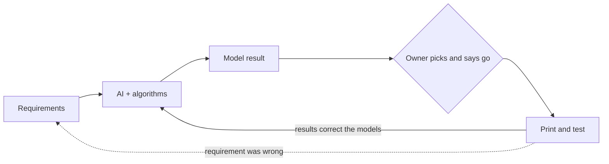

# Architecture

Requirements are measurable input. AI and algorithms are the process. A model is the output. Most feedback corrects the process. A wrong requirement is a separate, rarer path.

Form comes from functional evaluators. A fillet radius is a generator parameter, not an objective. If a round junction is better, stress, snag, or corner water has to say so.

## Interfaces

| Piece | Role | Where |
|---|---|---|
| `Requirements` | Load `requirements.yaml` and check the schema. Units and fit stay here. | `gendesign/requirements.py` |
| `Generator` | `bounds()` and `generate(x)` turn a parameter vector into a design. Topology optimization, Voronoi, lattice, TPMS, or a pocket size all fit. | `gendesign/process.py` |
| `Evaluator` | `evaluate(design)` returns objectives (all maximized), a constraint violation, metrics, and uncertainties. Pluggable. | `gendesign/process.py` |
| `Search` | Seeded `run()`. Writes the config it actually used. | `gendesign/process.py` |
| `Result` | Pareto set, the parameters, reasons as the metrics, uncertainties. STL export stays with the model. | `gendesign/process.py` |
| `Feedback` | A measurement that corrects an evaluator is a `Calibration`. A measurement that says the input was wrong is a `RequirementFlag`. | `gendesign/process.py` |
| `IterationLog` | Renders, stats, critique, contact sheet. | `gendesign/iterate.py` |

A model under `models/` supplies one generator and its evaluators. It does not grow a second search loop. Historical scripts (smooth v2, Voronoi A/B/C, legacy C) stay where they are. They are the record, not a second framework.

## What a run records

Seed, method, population, generations, generator name, evaluator names, bounds. The same seed and config rebuild the same front. Uncertainties name what the evaluator does not know (orifice Cd, plane-stress instead of a plate, printed holes running small).

## Feedback

`Calibration` changes an evaluator setting for the next pass (a film model, a stress scale, a hole undersize). It does not edit `requirements.yaml`. `RequirementFlag` is the rare case: the owner measured a different hole, or a dimension was assumed. That one goes back to requirements, and only the owner changes the file.
