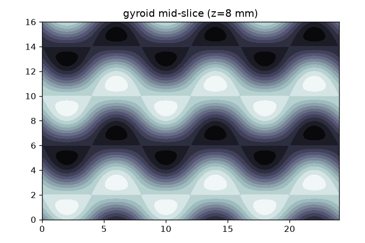

# Example: gyroid TPMS block

Runnable demo of the `gendesign` package (`gendesign gyroid` is the same mesher).

```bash
python examples/gyroid_shell/run.py
```

Writes `out/gyroid.stl` and a mid-slice preview.


