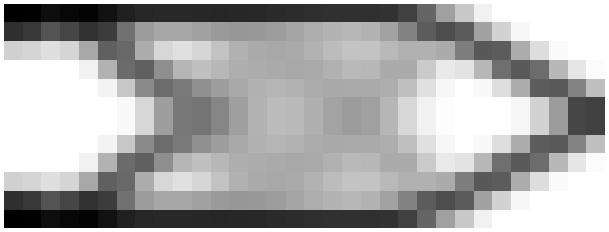

# Example: 2-D SIMP cantilever

Runnable demo of the `gendesign` package (`gendesign topopt2d` is the same solver).

```bash
python examples/topopt_bracket/run.py --quick
```

Writes `out/density.png`, `out/stats.json` and an extruded `out/part.stl`.
This is a laptop-scale compliance minimization, not a validated structural part.


