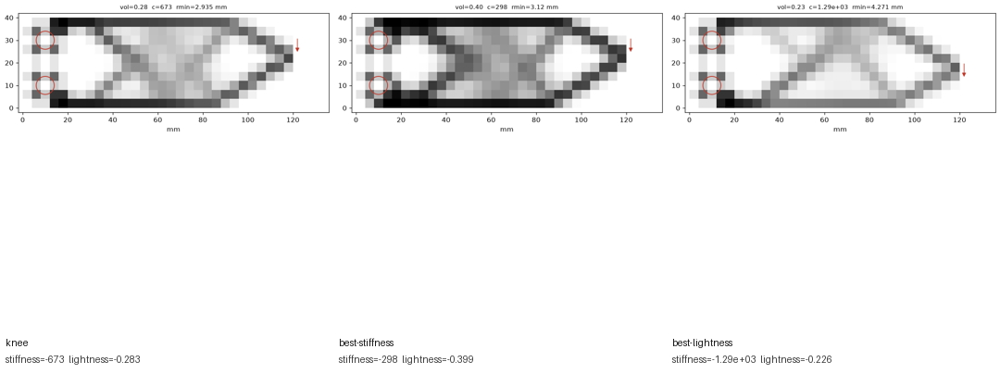
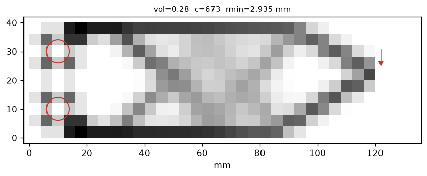

# cantilever-bracket — design report

Generated by `gendesign report` on 2026-11-15. Source of truth: `requirements.yaml`, `analysis.md`, and each round's `decisions.md`. Nothing here was printed unless a test record says so.

## Requirements

Thin steel plate bracket: two bolt holes on the left edge carry a downward tip load on the right. Topology optimization finds a light stiff layout inside a rectangular design space. Yield is recorded for reference; the round scores compliance and mass, not stress.

| Function | Value |
|---|---:|
| tip_load_N | 50.0 |
| print_flat | True |

Fit: length_mm 120.0, height_mm 40.0, thickness_mm 5.0, bolt_diameter_mm 8.0, bolt_cx_mm 10.0, bolt_cy_mm [10.0, 30.0], washer_extra_mm 3.0

## Analysis

From `analysis.md` (2026-11-15). Concept: **2-D SIMP topology** (generator `topopt-bracket`).

| Target | Value | From |
|---|---:|---|
| tip_load_N | 50.0 | function.tip_load_N |
| volfrac_max | 0.4 | constraints.volfrac_max |
| min_feature_mm | 2.0 | constraints.rmin_mm_min |
| domain_mm | [120.0, 40.0, 5.0] | fit.length/height/thickness_mm |

- Load 50 N binds the layout; volume ≤ 40% trades mass against stiffness.
- Steel E=200.0 GPa, σ_y≈250.0 MPa (yield not constrained in this round).
- Print flat (thickness = build Z): in-plane overhang filter off.

- **2-D SIMP topology** (chosen)
- **parametric two-bar truss** (rejected)

Open questions for the owner:

- Tip load 50 N is a stated design load, not a measured service load.
- Yield 250 MPa is reference only; the round does not constrain stress.

## Rounds

### topopt-bracket / round 00 — awaiting AI review

2026-11-15 · nsga2 pop 4 × 2 gens, seed 1 · front 4 · [decisions](designs/topopt-bracket/iterations/00/decisions.md)

| Pick | stiffness | lightness |
|---|---:|---:|
| knee | -673 | -0.283 |
| best-stiffness | -298 | -0.399 |
| best-lightness | -1.29e+03 | -0.226 |

#### AI review of the renders and the scores

_AI: pending._

#### Proposed next

_AI: pending._

#### Owner decision

Pending. Only the owner records this: `gendesign approve <this folder> <pick>`. Nothing is printed before that.

## Records

Designs kept as history. Each folder has its own design.json and, if printed, test.md.

| Design | Preview | Rounds | Tests |
|---|---|---:|---|
| [topopt-bracket](designs/topopt-bracket/) |  | 1 | — |
