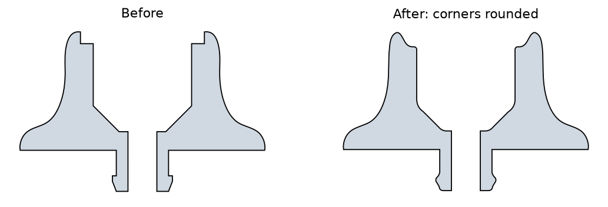

# Drybox adapter

Worked example in [gendesign](../../README.md): a small grommet that holds a PTFE bowden insert in a filament-dryer wall:
flared mouth, pocket, 45° cone floor, barbed stem. Default **v9, P = 8.85 mm**.



Read [SKILL.md](SKILL.md) before changing this model.

```bash
python models/drybox-adapter/generate.py           # P=8.85
python models/drybox-adapter/generate.py -P 8.9
python models/drybox-adapter/optimize.py --quick   # pocket sweep
```

**Printed holes come out about 0.1–0.2 mm undersized.** Measure the insert
and test-fit; a pocket drawn at the pin size is often too tight. This is a
parameter sweep, not a topology problem. Recommend 100% infill on this
small part, no supports, no ledges over the through-bore.

Do not start a print until the owner says go.
