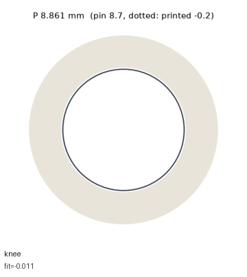
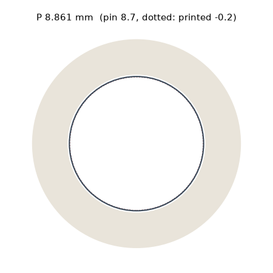
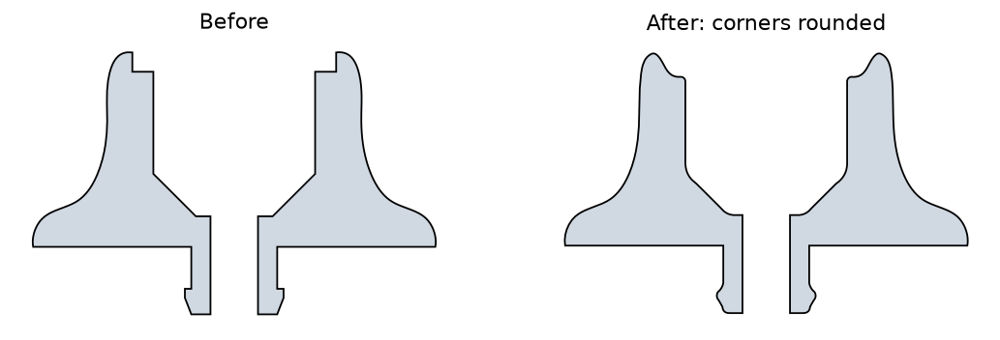

# drybox-adapter — design report

Generated by `gendesign report` on 2026-11-14. Source of truth: `requirements.yaml`, `analysis.md`, and each round's `decisions.md`. Nothing here was printed unless a test record says so.

## Requirements

A small grommet adapter that holds a PTFE bowden insert in a filament-dryer wall: flared mouth, pocket, 45° cone floor (no flat ledge over air), barbed stem.

## Analysis

From `analysis.md` (2026-11-14). Concept: **pocket sweep** (generator `pocket`).

| Target | Value | From |
|---|---:|---|
| pocket_mm | 8.85 | constraints.pin_mm + print_hole_undersize_mm |
| pocket_band_mm | [8.8, 8.9] | print_hole_undersize_mm |
| cone_floor_deg | 45.0 | constraints.cone_floor_deg |

- v9 was drawn at 8.85 mm, inside the band. Fit, not strength, decides this part.

- **pocket sweep** (chosen)
- **topology optimization** (rejected)

Open questions for the owner:

- Confirm the insert still does not go straight into the dryer wall hole; then the adapter is unneeded.

## Rounds

### pocket-sweep / round 00 — reviewed, awaiting owner

2026-11-14 · nsga2 pop 6 × 2 gens, seed 3 · front 1 · [decisions](designs/pocket-sweep/iterations/00/decisions.md)

| Pick | fit |
|---|---:|
| knee | -0.011 |

#### AI review of the renders and the scores

The search converged on 8.861 mm, 0.011 mm from the 8.85 mm target, and the mesh is watertight with nothing over air. That is by construction: with one gene and a target from the analysis, the optimizer can only find the target. It confirms the loop, not the fit.

The scores cannot settle this part. The fit evaluator knows the pin (8.7 mm, one insert, calipered) and a 0.1–0.2 mm undersize band from one earlier print with no logged diameter. The 0.1 mm width of that band is as large as the whole difference between "too tight" and "rattles". Only a printed pocket measured on the real insert narrows it.

#### Proposed next

1. Owner: approve three coupons at the analysis band, 8.80 / 8.85 / 8.90 mm (`gendesign generate` each with `-o`), and print them at 100% infill, no supports.
2. Bench: caliper each printed pocket and test the insert. Write `- calibrate: fit.undersize_mm = <drawn − printed>` in the coupon's test.md, run `gendesign feedback`, then `gendesign analyze`. The target moves by the measured undersize.
3. First check that the insert still does not go straight into the dryer wall hole. If it does, this part is not needed.

#### Owner decision

Pending. Only the owner records this: `gendesign approve <this folder> <pick>`. Nothing is printed before that.

## Records

Designs kept as history. Each folder has its own design.json and, if printed, test.md.

| Design | Preview | Rounds | Tests |
|---|---|---:|---|
| [pocket-sweep](designs/pocket-sweep/) |  | 1 | — |
| [v9-8.85](designs/v9-8.85/) |  | 0 | [v9-8.85](designs/v9-8.85/test.md) |
