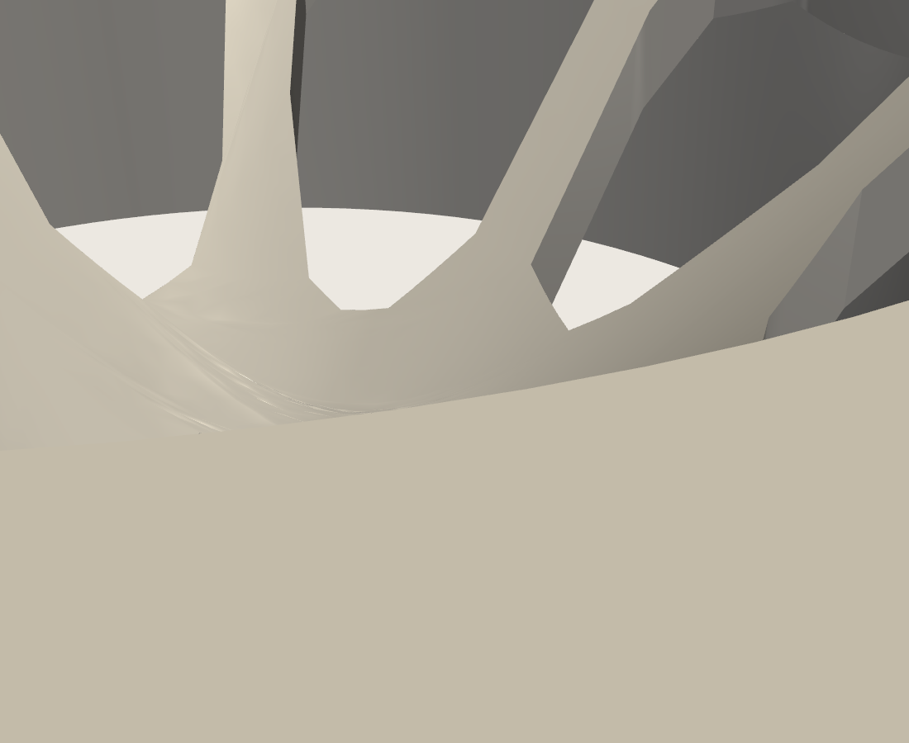
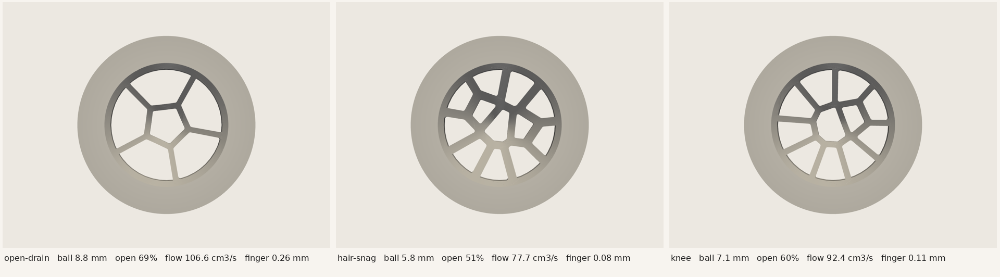
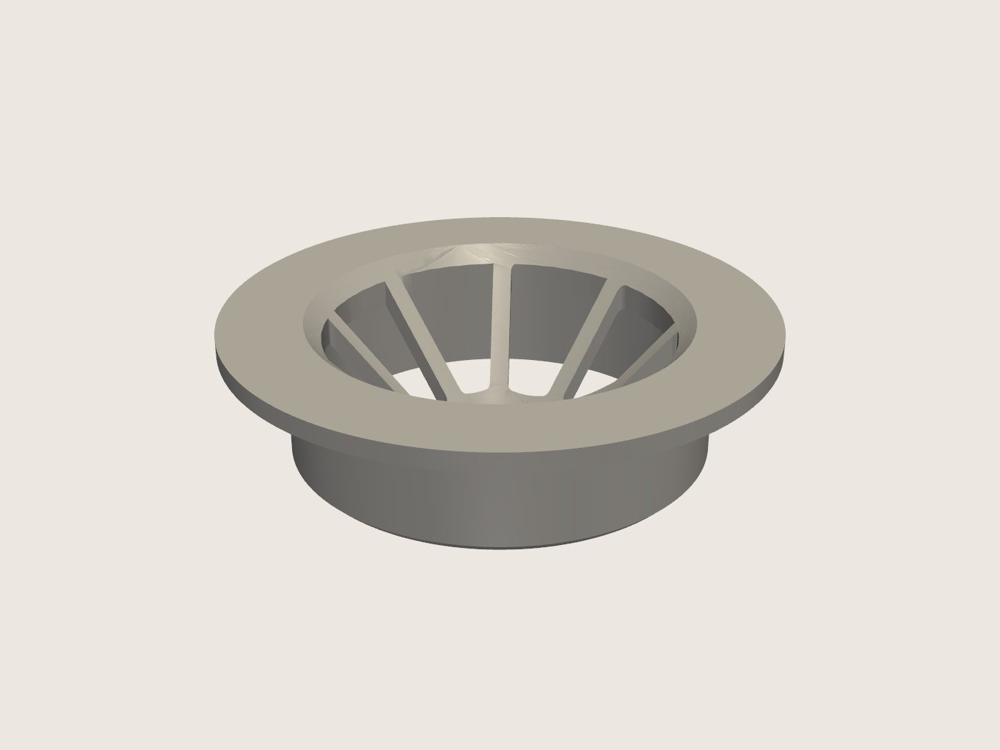
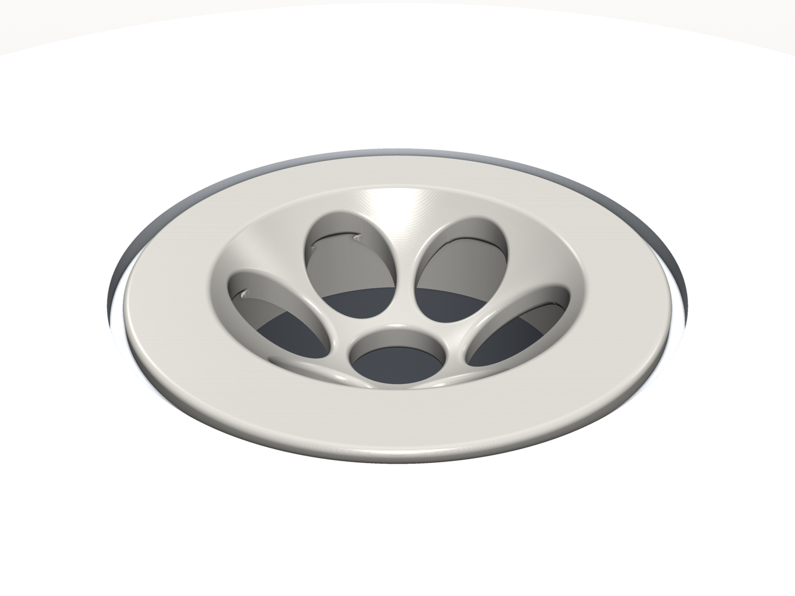

# Hair catcher / basin guard

Worked example of AI + generative design in [gendesign](../../README.md): a press-fit washbasin drain insert. The agent reviews each round and redirects the next one. The code computes the grate and searches it. The **saved reference** is still the smooth v2 7-hole
bowl: hair and water fall through; a ball larger than **8.6 mm** does not.
Earlier two-level Voronoi versions (A, B, C) are hair catchers, not toy
guards. A deeper side-slot basket (v3) is included as an experiment.

The round 02 knee is the geometry the owner kept (17.9 mm insert, 35.10 mm collar). Round 03 did not add a smoothness target. It asked whether stress, hair snag, and corner water would round that layout on their own. Log: [iterations/03](designs/generative-v1/iterations/03/decisions.md). Drain note: [test.md](designs/generative-v1/test.md).










Read [SKILL.md](SKILL.md) before changing this model.

## Quick start

```bash
python models/hair-catcher/generate.py
# writes out/smooth-v2/ (or -o DIR): *-print.stl, *-use.stl, STEP, stats JSON
```

Print orientation: `*-print.stl` has the **flange on the bed**, collar up,
no supports. 0.2 mm PLA, A1 mini profile. Small-part infill is up to you;
100% is a safe recommendation. Stand-in slice (PrusaSlicer, not Orca/Bambu):
about **17 min 17 s, 5.36 g**, 59 layers.

## How to measure your drain

Caliper the open hole, the seating rim, and how deep the bore stays clear
(stopper / overflow / crossbar). Defaults assume a ~35 mm De40 hole, a
Ø46 × 1.6 mm flange (the seat was **not** measured), and 10.2 mm of insert
depth. See `requirements.yaml` and the skill.

## Methods

```bash
python models/hair-catcher/optimize.py --method generative
python models/hair-catcher/optimize.py --method smooth --quick
python models/hair-catcher/optimize.py --method deep --quick
```

Round 02, same orifice model (Cd 0.61, 5 mm head). v2 volume is the published solid. Cone volumes include the skirt. The round 01 knee was the previous favorite. Limits are in the round log.

| Pick | Open | Max ball | Smallest cell | Flow | Film | Fingertip, 10 N | Volume |
|---|---:|---:|---:|---:|---:|---:|---:|
| smooth v2 | 50.5% | 8.6 mm | 8.6 mm | 78 cm³/s | 0 | 0.04 mm | 4304 mm³ |
| round 01 knee | 59.8% | 6.3 mm | 4.3 mm | 92 cm³/s | 0 | 0.49 mm | 3656 mm³ |
| open-drain | 69.4% | 8.8 mm | 8.7 mm | 107 cm³/s | 0 | 0.26 mm | 3550 mm³ |
| knee | 60.1% | 7.1 mm | 4.5 mm | 92 cm³/s | 0 | 0.11 mm | 3802 mm³ |
| hair-snag | 50.6% | 5.8 mm | 4.1 mm | 78 cm³/s | 0 | 0.08 mm | 3978 mm³ |

| Design | What it is | Docs |
|---|---|---|
| [smooth-v2](designs/smooth-v2/) | Default filleted 7-hole bowl (50.54% open, 8.6 mm ball, 1.8 mm struts, ~4304 mm³) | [iterations](designs/smooth-v2/iterations/), [chart](docs/optimization-chart.png) |
| [voronoi-a](designs/voronoi-a/) | Small-cell two-level hair catcher | [top](docs/preview-voronoi-a-top.png) |
| [voronoi-b](designs/voronoi-b/) | Larger-cell drainage revision | [top](docs/preview-voronoi-b-top.png) |
| [voronoi-c](designs/voronoi-c/) | Rounded pebble cells; original public version C ([legacy-C](legacy-C/)) | [top](docs/preview-voronoi-c-top.png) |
| [deep-v3](designs/deep-v3/) | Experimental deep basket (~86% open, needs ~35 mm clear bore; look was not liked) | [section](docs/preview-section-v3-deep.png), [vs v2](docs/comparison-v2-vs-v3-deep.png) |

The original public version C — `build.py`, `design.py`, `search.py`,
`render.py`, metrics under `versions/C`, and `version-C.png` — is in
[`legacy-C/`](legacy-C/). Run those scripts from that folder. Dependencies
are the repo-root `requirements.txt`.

Do not start a print until the owner says go.
