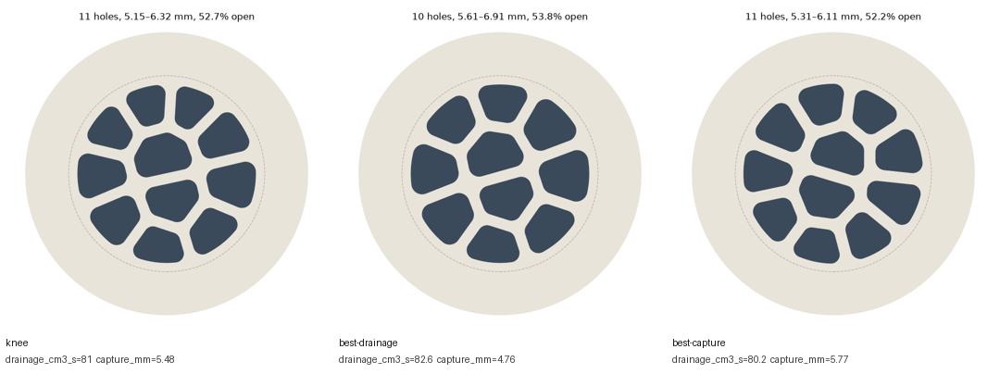

# Hair catcher

Worked example for [gendesign](../../README.md): a press-fit washbasin drain insert that catches hair and lets water through. It sits flush in a measured 35 mm drain hole and prints on an A1 mini in PLA with no supports.

**Review it here: [REPORT.md](REPORT.md).** Targets and concept: [analysis.md](analysis.md). Agent notes: [SKILL.md](SKILL.md).

## Where it stands

The analysis derived the targets from [requirements.yaml](requirements.yaml) before any geometry. Drainage binds: 408 mm² of open area, 51% of the bore, for the same flow as smooth v2 under the orifice model. Structure has 1.29x margin at a 2.2 mm plate. Holes must clear 4.0 mm because water holds a film below the 2.7 mm capillary length. A flat plate meets that, so it was chosen over a cone (needs ~18 mm of depth and runs at the overhang limit) and a two-level grate (bridges, or needs vaults, and loses flow).

Round 01 knee: 11 holes 5.2–6.3 mm, 424 mm² open, 81 cm³/s, hard-push stress 16.2 of 20 MPa, watertight, nothing over air. The review's open gap is hole rounding: no score rewards it yet. Not approved, not printed.



## Commands

```bash
gendesign analyze models/hair-catcher
gendesign round models/hair-catcher --from models/hair-catcher/designs/pebble-plate/iterations/01 --note "..."
gendesign report models/hair-catcher
gendesign generate models/hair-catcher models/hair-catcher/designs/pebble-plate/iterations/01/picks/knee
python models/hair-catcher/generate.py --design models/hair-catcher/designs/smooth-v2/design.json   # older designs
```

`print.stl` has the flush top face on the bed, collar up, no supports. 0.2 mm PLA, A1 mini profile, 100% infill. Do not start a print until the owner says go.

## Measure

Owner confirmed the clear hole at 35 mm (2026-11-15). Collar prints at 35.10 mm OD (CAD 35.21, 0.3% PLA shrink). Flange Ø46 × 1.6 mm is **assumed, not calipered**. The tap flow rate and the largest acceptable hole were never given; the analysis uses smooth v2's flow and the 12 mm cap, and lists both as open questions.

## Design history

| Design | What it is | Status |
|---|---|---|
| [pebble-plate](designs/pebble-plate/) | Rounds through `gendesign round`, generator `pebble-plate` in [model.py](model.py) | round 01 reviewed, awaiting owner |
| [pebble-e](designs/pebble-e/) | Single flat pebble plate, 15 holes 4.5–5.7 mm, 0 mm² over air, ~12 min, 4.1 g. The generator's starting point; rebuilds exactly. Fails today's 408 mm² target (366). | not printed |
| [pebble-d](designs/pebble-d/) | Two-level made self-supporting: funnel walls, vaulted fine layer, teardrop windows | not printed; fine cells near the film limit |
| [pebble-c](designs/pebble-c/) | Two-level pebble cells and branching struts, released as [v0.3.0-C](https://github.com/mayphus/gendesign/releases/tag/v0.3.0-C) | not printed; ~189 mm² bridges over air |
| [generative-v1](designs/generative-v1/) | NSGA-II cone of Voronoi cells, rounds 00–03 | round 02 knee chosen, not printed |
| [smooth-v2](designs/smooth-v2/) | Filleted 7-hole bowl, 8.6 mm ball, 50.5% open | earlier default, no bench test |
| [deep-v3](designs/deep-v3/) | Deep side-slot basket, ~86% open | experiment; look not liked |
| [voronoi-a](designs/voronoi-a/) / [b](designs/voronoi-b/) / [c](designs/voronoi-c/) | Two-level Voronoi mesh pipeline | **A printed 2026-11-12: water hung in ~1 mm cells** ([test.md](designs/voronoi-a/test.md)) |

Scripts that made the older designs are in [archive/](archive/README.md).
