# hair-catcher — design report

Generated by `gendesign report` on 2026-11-14. Source of truth: `requirements.yaml`, `analysis.md`, and each round's `decisions.md`. Nothing here was printed unless a test record says so.

## Requirements

Press-fit washbasin drain insert that catches hair and lets water through. It sits flush in a measured 35 mm drain hole, prints on an A1 mini in PLA with no supports, and survives a fingertip press and a hard push.

| Function | Value |
|---|---:|
| drain_flow_min_cm3_s | 78.0 |
| fingertip_load_N | 10.0 |

Fit: drain_id_measured_mm 35.0, drain_straight_depth_stated_mm 100, collar_od_print_mm 35.1, shrink 0.003, collar_wall_mm 1.6, flange_diameter_mm 46.0, flange_thickness_mm 1.6, lead_in_mm 0.7, collar_engagement_mm 10.2

## Analysis

From `analysis.md` (2026-11-14). Concept: **flat plate** (generator `pebble-plate`).

| Target | Value | From |
|---|---:|---|
| open_area_min_mm2 | 408 | function.drain_flow_min_cm3_s, physics.cd, physics.head_mm |
| open_fraction_min | 0.508 | open_area_min_mm2 / bore area |
| hole_min_mm | 4.0 | constraints.opening_floor_mm; capillary length |
| hole_max_mm | 12.0 | constraints.max_ball_mm |
| plate_t_min_mm | 1.94 | constraints.fingertip_N, hard_push_N, max_fingertip_disp_mm; physics.E_MPa |
| rib_min_mm | 1.5 | constraints.min_strut_mm |
| rim_min_mm | 1.35 | constraints.min_rim_mm |

- At the 2.2 mm plate and 51% open: fingertip deflection 0.088 mm (limit 0.5), hard-push rib stress 15.5 MPa (allowable 20). Structure is close: 1.29x on the tighter of the two, so the plate stays at 2.2 mm (minimum 1.94).
- Drainage binds: 408 mm² of open area is 51% of the bore.
- A flat plate with 1.5 mm ribs reaches that with holes of about 5.3 mm inscribed (hexagonal estimate, ±15%). A 47.0° cone has 1.47x the area, so holes can drop to the 4.0 mm floor.

- **flat plate** (chosen)
- **cone** (fallback)
- **two-level** (rejected)

Open questions for the owner:

- No tap flow was given. The flow target is smooth v2's 78 cm³/s under the same orifice model; a measured tap rate should replace it (function.drain_flow_min_cm3_s).
- No largest acceptable hole was given beyond the 12 mm cap. Capture is maximized, not bounded.
- allowable_MPa 20 is a layer-line PLA guess, not a test.

## Rounds

### pebble-plate / round 00 — reviewed, awaiting owner

2026-11-14 · nsga2 pop 16 × 6 gens, seed 7 · front 12 · [decisions](designs/pebble-plate/iterations/00/decisions.md)

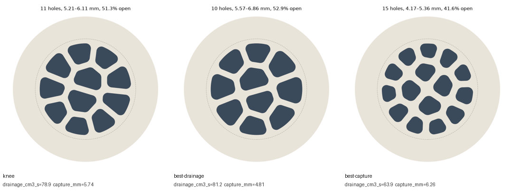

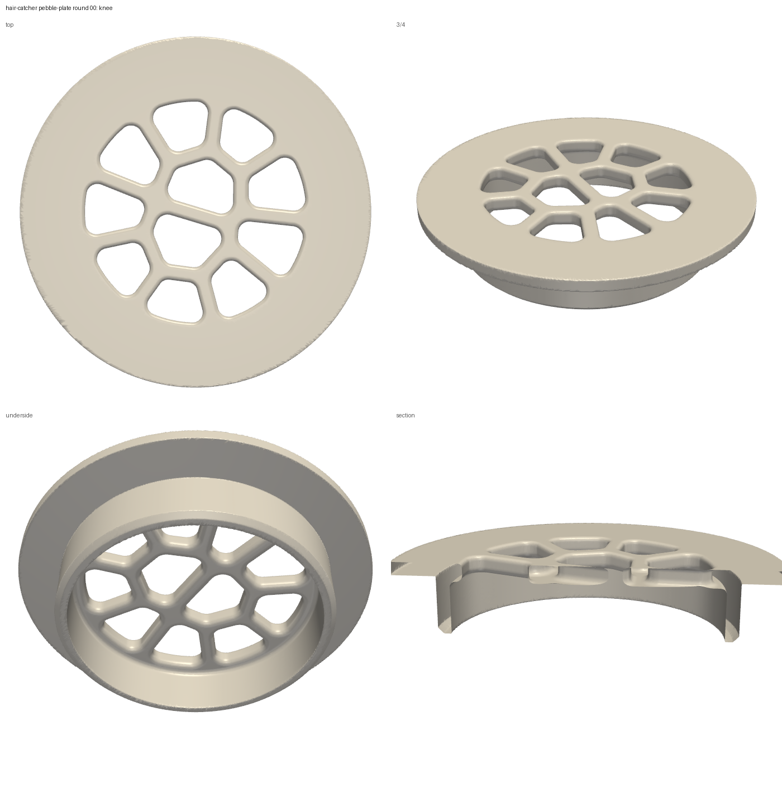

| Pick | drainage_cm3_s | capture_mm |
|---|---:|---:|
| knee | 78.9 | 5.74 |
| best-drainage | 81.2 | 4.81 |
| best-capture | 63.9 | 6.26 |

#### AI review of the renders and the scores

Same orifice model for every row (Cd 0.61, 5 mm head). pebble-e is scored here with the round's evaluators; it fails only the 1.35 mm rim floor (its edge rib is 1.2 mm).

| | Holes | Ball range | Open | Flow | Capture |
|---|---:|---:|---:|---:|---:|
| pebble-e (start) | 15 | 4.53–5.70 mm | 45.5% | 70.0 cm³/s | 5.95 |
| knee | 11 | 5.21–6.11 mm | 51.3% | 78.9 cm³/s | 5.74 |
| best-drainage | 10 | 5.57–6.86 mm | 52.9% | 81.2 cm³/s | 4.81 |
| best-capture | 15 | 4.17–5.36 mm | 41.6% | 63.9 cm³/s | 6.26 |

The search did what the scores asked. The knee drains 13% more than pebble-e for a 0.4 mm larger worst hole, and it matches smooth v2's 78 cm³/s with a 6.1 mm ball instead of 8.6 mm. All three picks are flat plates with nothing printed over air, so printability did not trade against anything here.

What the pictures show that the scores do not:

1. **The holes got squarer.** round_frac sits at its lower bound (0.50) on the knee and best-drainage. A less rounded hole has more area, so drainage pulls it there and nothing pulls back. Next to pebble-e the knee reads as rounded polygons, not pebbles. This is the round 03 lesson again: if a round hole is better, a functional score has to say so. `gendesign.corners` already measures hair snag and corner water on the boundary; it is not in this model yet.
2. **Grade collapsed.** The front's grade runs 0.00–0.16, and the knee is at 0.00: even cells. Capture rewards a small worst hole and penalizes max-median spread, which an even pattern wins. That is consistent, not a bug. A graded "fine at the rim" catcher would need a capture score that weights where hair lands.
3. **seed is doing too much.** The knee (seed 217) and best-drainage (216) share every other gene to three decimals. Changing the seed by one gives a different layout, so NSGA-II is mostly sampling patterns through that gene. Six seeds survive on the front.
4. Stiffness is not scored. Every rib is at least 2.04 mm on a 2.2 mm plate, wider than the 1.8 mm v2 struts, but a 10 N fingertip check is still owed before a print.

The knee is the candidate I would take forward. I would not print it from this round: the squarer holes are a scoring gap, not a choice anyone made.

#### Proposed next

1. Add a corner evaluator (hair snag and corner water from `gendesign.corners`) as a third objective, so rounding has to earn its place against drainage.
2. Hold the layout seed: continue from this round (`--from iterations/00`) with seed fixed per family, and let the continuous genes refine.
3. Owner: say whether a 6.1 mm worst hole is acceptable, or whether capture should stay near pebble-e's 5.7 mm.

#### Owner decision

Pending. Only the owner records this: `gendesign approve <this folder> <pick>`. Nothing is printed before that.

### pebble-plate / round 01 — reviewed, awaiting owner

2026-11-14 · nsga2 pop 16 × 6 gens, seed 11 · front 9 · [decisions](designs/pebble-plate/iterations/01/decisions.md)

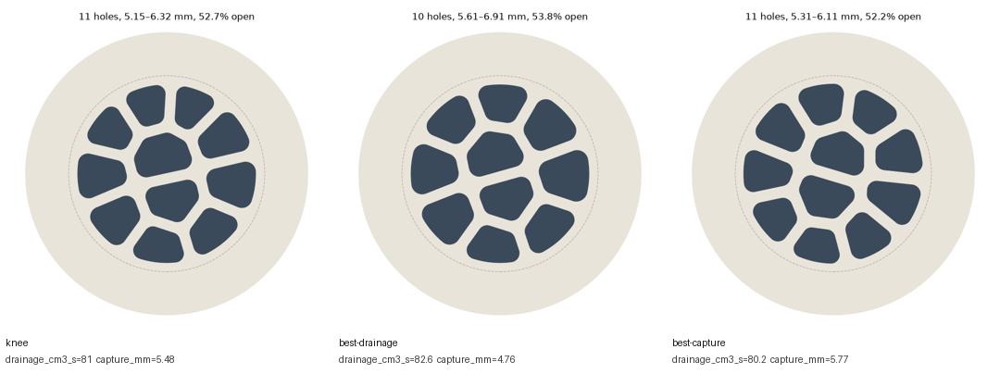

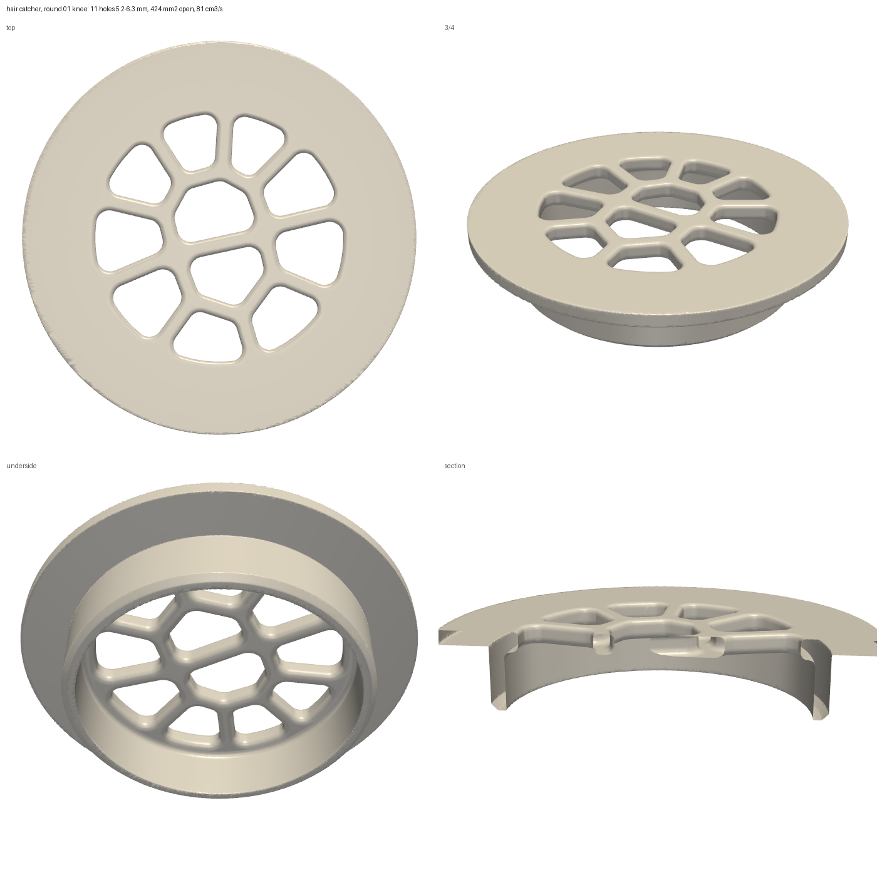

| Pick | drainage_cm3_s | capture_mm |
|---|---:|---:|
| knee | 81 | 5.48 |
| best-drainage | 82.6 | 4.76 |
| best-capture | 80.2 | 5.77 |

#### AI review of the renders and the scores

Every pick meets the analysis targets: open area 420–432 mm² against 408, holes 5.2–6.9 mm against the 4.0 mm floor, plate stress 16.0–16.5 MPa against 20, fingertip 0.09–0.10 mm against 0.5. All three meshes are watertight, one body, nothing over air.

| | Holes | Ball range | Open area | Flow | Hard push | Fingertip |
|---|---:|---:|---:|---:|---:|---:|
| round 00 knee | 11 | 5.21–6.11 mm | 412 mm² | 78.9 cm³/s | — | — |
| knee | 11 | 5.15–6.32 mm | 424 mm² | 81.0 cm³/s | 16.2 MPa | 0.095 mm |
| best-drainage | 10 | 5.61–6.91 mm | 432 mm² | 82.6 cm³/s | 16.5 MPa | 0.100 mm |
| best-capture | 11 | 5.31–6.11 mm | 420 mm² | 80.2 cm³/s | 16.0 MPa | 0.093 mm |

The analysis predicted a flat plate would meet the flow target with holes near 5.3 mm. The front sits at 5.2–6.9 mm, so the hexagonal estimate was close. The flow constraint did its job: only 2 of 16 starting designs were feasible, and the whole population was by generation 4. round 00's knee (412 mm²) would only just pass.

What the renders show that the scores do not:

1. **The holes are still rounded polygons.** round_frac is at its 0.50 lower bound on every pick. Nothing in the scores rewards a rounder hole, and drainage rewards area. This is the same gap as round 00, and the analysis does not close it: corner radius is a hair-snag and corner-water question, and `gendesign.corners` already measures both.
2. **Exploration narrowed.** Seeding from round 00 kept two layouts (seeds 216 and 217). The picks are refinements of one pattern, not alternatives. That is right for refinement and wrong for a first look at a constrained space.
3. **Structure is now the second constraint.** At 53% open, hard-push stress is 16 MPa, 0.8 of the 20 MPa allowable, and that allowable is a guess. More open area will run into it before it runs into the deflection limit.

The knee is the candidate. Flow is 4% above the target, capture is close to round 00, and it has structural margin. I would not print it until the corner gap is scored and a 30 N press test confirms the allowable.

#### Proposed next

1. Add the corner evaluator (`gendesign.corners`: hair snag and corner water) as a third objective, so rounding competes with drainage instead of sitting at its bound.
2. Run the next round cold (no `--from`) with the analysis constraints, to check that 216/217 is not a local pick.
3. Owner: a measured tap flow rate and the largest acceptable hole would replace the two assumed targets in `analysis.md`.
4. Bench: a 30 N press on a printed coupon calibrates `structure.allowable` via `- calibrate:` in its test.md.

#### Owner decision

Pending. Only the owner records this: `gendesign approve <this folder> <pick>`. Nothing is printed before that.

### pebble-plate / round 02 — reviewed, awaiting owner

2026-11-14 · nsga2 pop 24 × 8 gens, seed 23 · front 4 · [decisions](designs/pebble-plate/iterations/02/decisions.md)

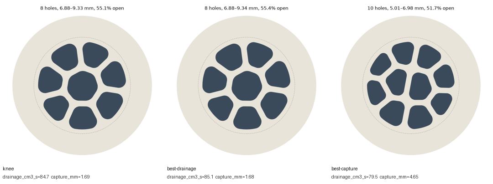

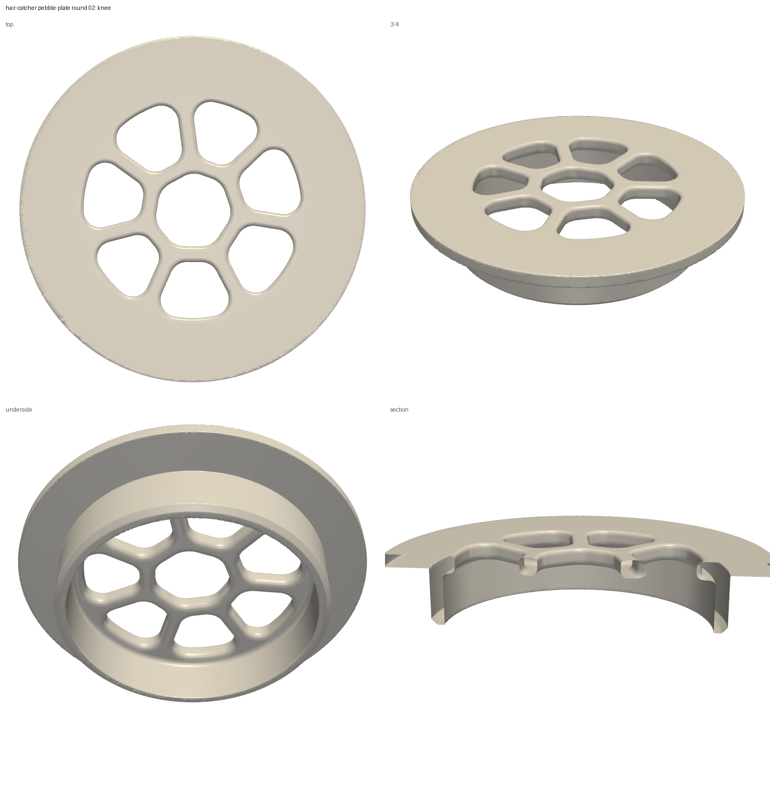

| Pick | drainage_cm3_s | capture_mm |
|---|---:|---:|
| knee | 84.7 | 1.69 |
| best-drainage | 85.1 | 1.68 |
| best-capture | 79.5 | 4.65 |

#### AI review of the renders and the scores

Both questions from round 01 have an answer.

**Corners: settled by function.** Every pick passes the new corners constraint with zero hair snag and zero corner water; the tightest corner is 1.49–2.12 mm. The search moved round_frac to 0.60–0.62 here without being asked, because the corner score is a constraint, not a reward. Rounding is no longer an open gap.

**Is round 01's layout a local pick? No, it is the better one.** A cold search twice as large (24 × 8, 192 evaluations) found a sparse front: 4 designs, and none feasible in the first two generations. The flow target leaves a narrow feasible region and the integer layout seed makes it rugged. Across rounds 01 and 02 (same targets), the combined front is:

| Source | Holes | Ball range | Open area | Flow | Capture | Hard push |
|---|---:|---:|---:|---:|---:|---:|
| round 01 best-capture (seed 217) | 11 | 5.31–6.11 mm | 420 mm² | 80.2 cm³/s | 5.77 | 16.0 MPa |
| **round 01 knee (seed 216)** | 11 | 5.15–6.32 mm | 424 mm² | 81.0 cm³/s | 5.48 | 16.2 MPa |
| round 02 knee (seed 178) | 8 | 6.88–9.33 mm | 443 mm² | 84.7 cm³/s | 1.69 | 17.0 MPa |
| round 02 best-capture (seed 397) | 10 | 5.01–6.98 mm | 416 mm² | 79.5 cm³/s | 4.65 | 15.8 MPa |

Round 02's best-capture is dominated by round 01's knee on both objectives. Round 02's knee is a different product: 4.6% more flow for holes as big as smooth v2's 8.6 mm ball. With a 4-point front, the "knee" rule picked an end of a gap, not a balance. That is a limit of knee selection on a sparse front, not a recommendation.

**The candidate stays round 01's knee**: 11 holes, 5.2–6.3 mm, 81 cm³/s (4% over target), 16.2 of 20 MPa, corners 1.29 mm (rounder than both proxy radii), watertight, nothing over air.

#### Proposed next

1. Owner: the round 01 knee is ready for your decision. If you want it printed, run `gendesign approve models/hair-catcher/designs/pebble-plate/iterations/01 knee`, then `gendesign generate` it. The AI will not approve.
2. Before or with that print: caliper the flange seat (Ø46 is assumed), and if you can, give the tap flow rate and the largest hole you would accept. Those two replace the assumed targets in `analysis.md`.
3. After the print: time a litre through it and press it at 30 N. Write both as `calibrate:` lines (`drainage.cd`, `structure.allowable_MPa`) in its test.md.
4. Search: treat the layout seed as a discrete choice (multi-start over seeds, continuous genes per seed) so a cold round does not depend on luck. Only worth it if the owner wants another round before printing.

#### Owner decision

Pending. Only the owner records this: `gendesign approve <this folder> <pick>`. Nothing is printed before that.

## Records

Designs kept as history. Each folder has its own design.json and, if printed, test.md.

| Design | Preview | Rounds | Tests |
|---|---|---:|---|
| [deep-v3](designs/deep-v3/) | 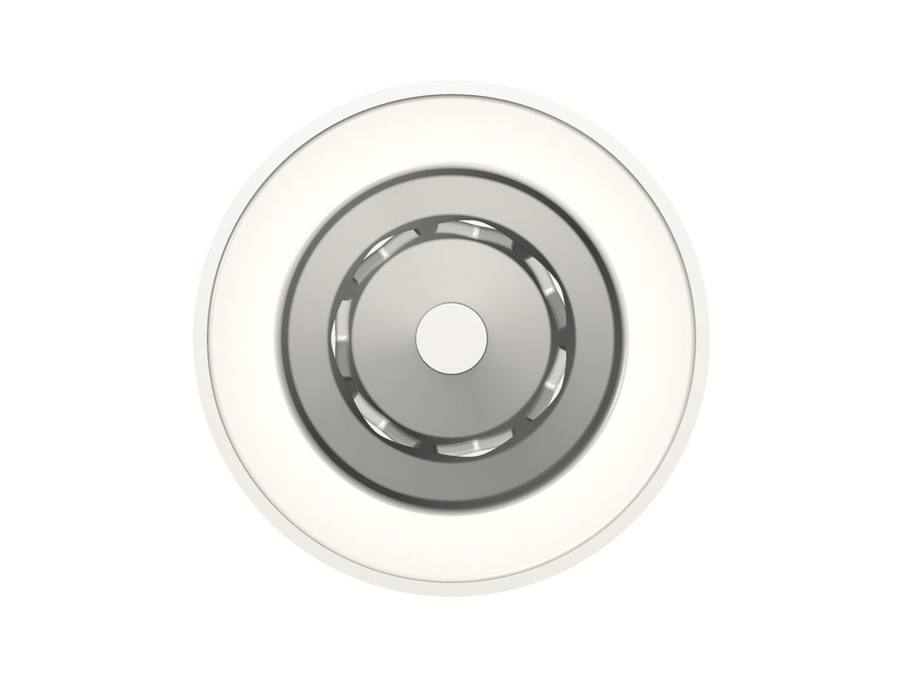 | 25 | — |
| [generative-v1](designs/generative-v1/) | 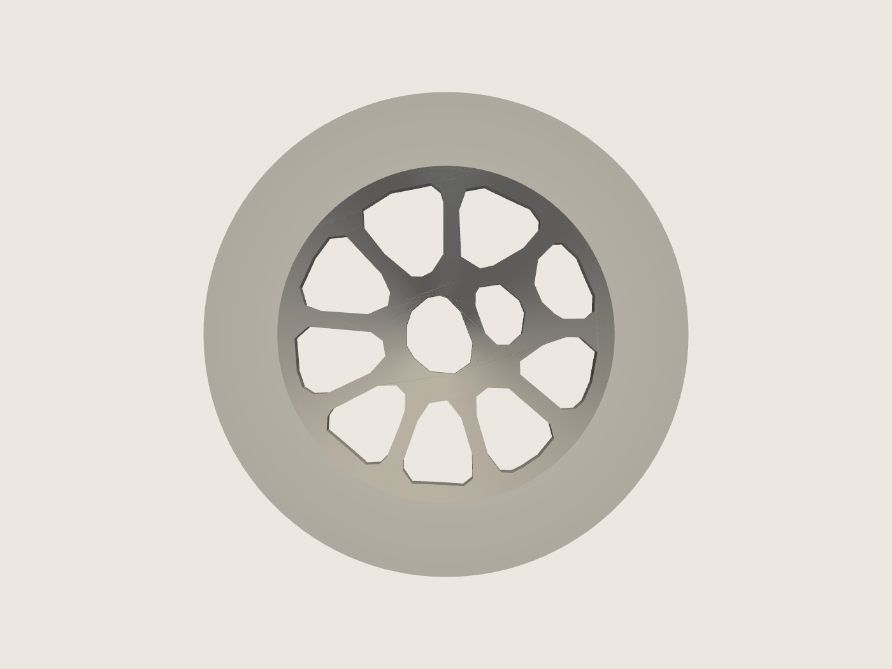 | 4 | [generative-v1](designs/generative-v1/test.md) |
| [pebble-c](designs/pebble-c/) | 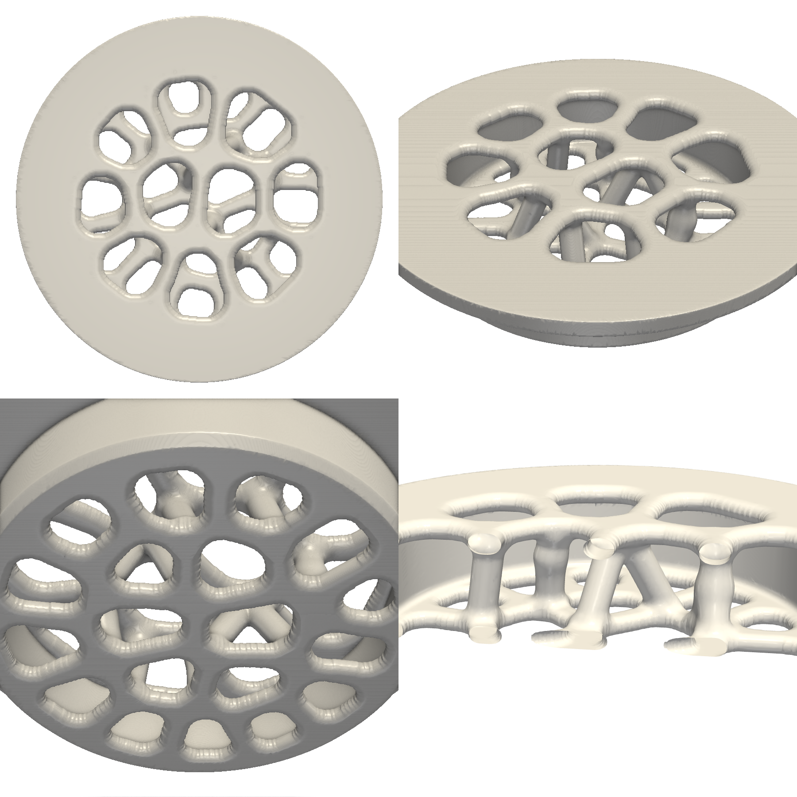 | 0 | — |
| [pebble-d](designs/pebble-d/) | 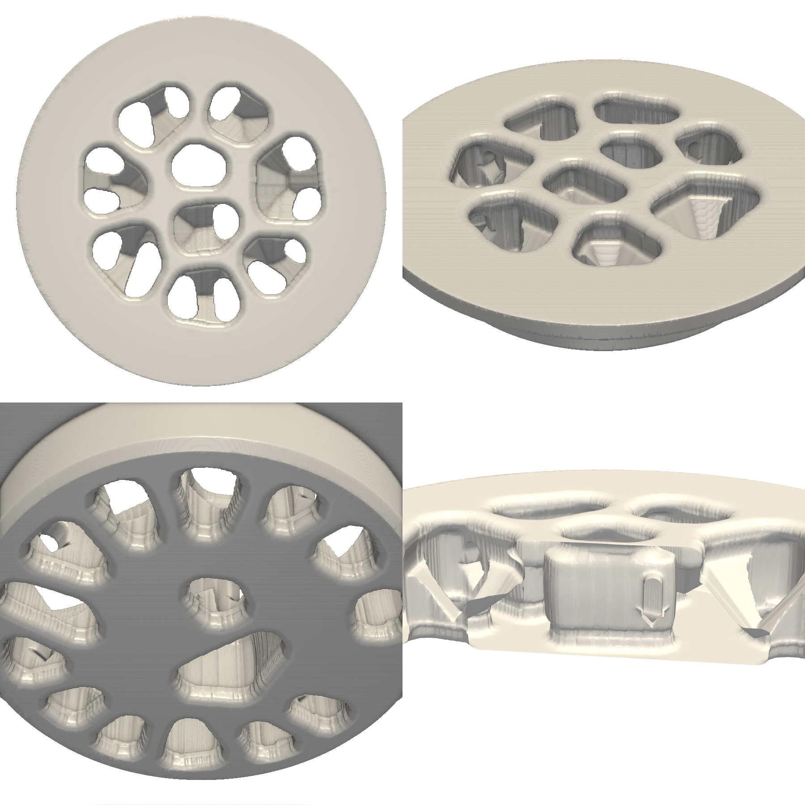 | 0 | — |
| [pebble-e](designs/pebble-e/) | 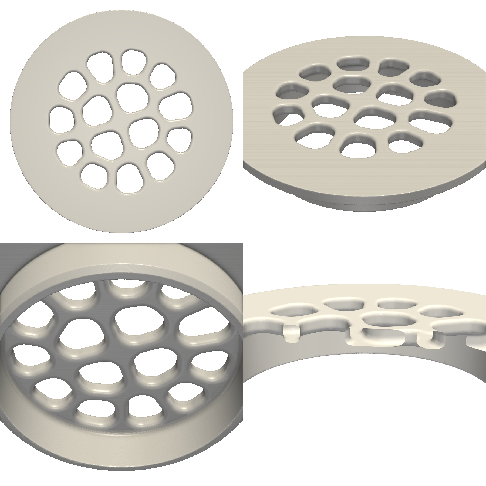 | 0 | — |
| [pebble-plate](designs/pebble-plate/) | 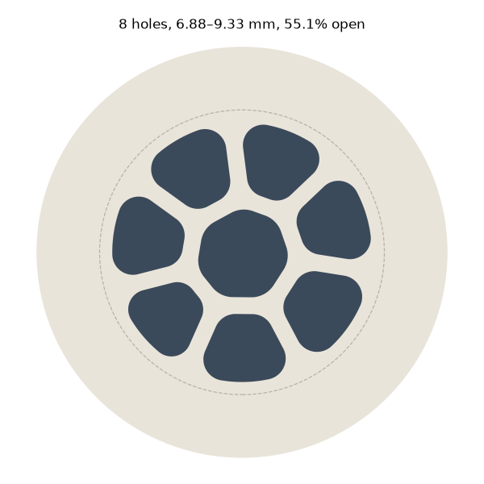 | 3 | — |
| [smooth-v2](designs/smooth-v2/) | 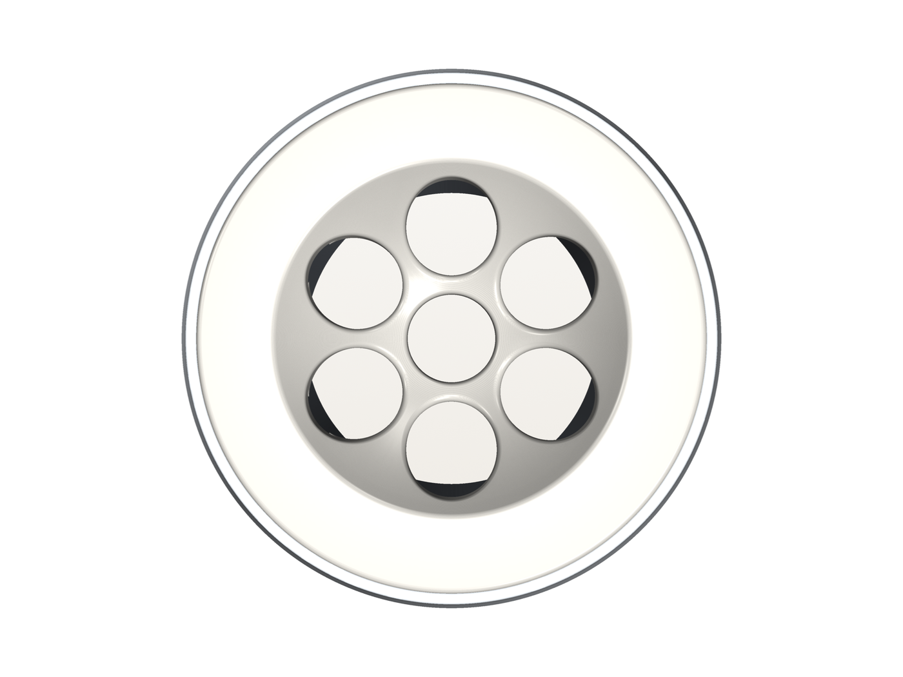 | 13 | — |
| [voronoi-a](designs/voronoi-a/) | 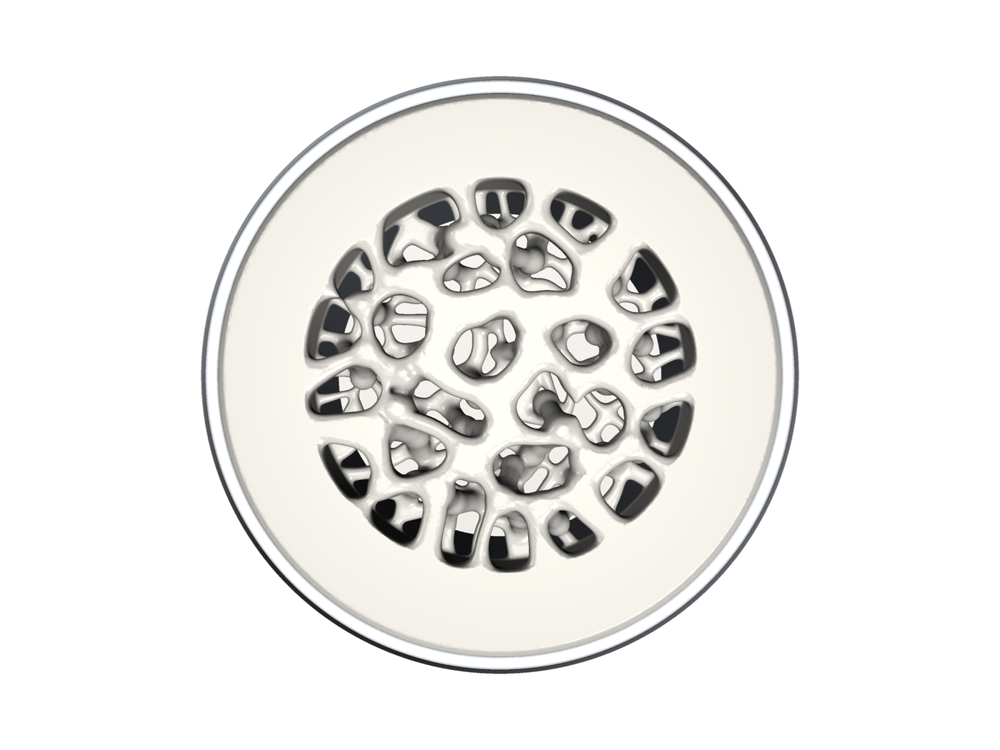 | 0 | [voronoi-a](designs/voronoi-a/test.md) |
| [voronoi-b](designs/voronoi-b/) | 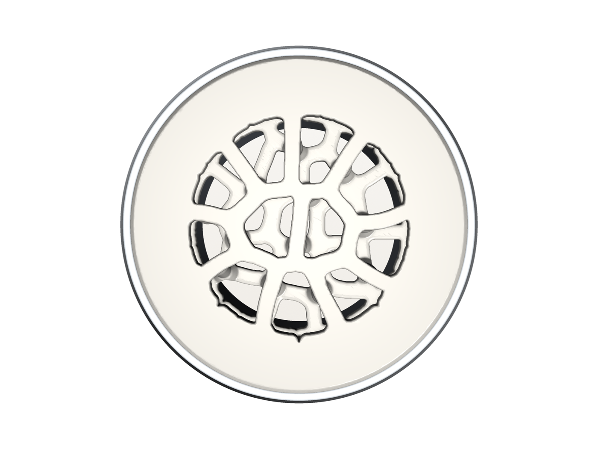 | 0 | — |
| [voronoi-c](designs/voronoi-c/) | 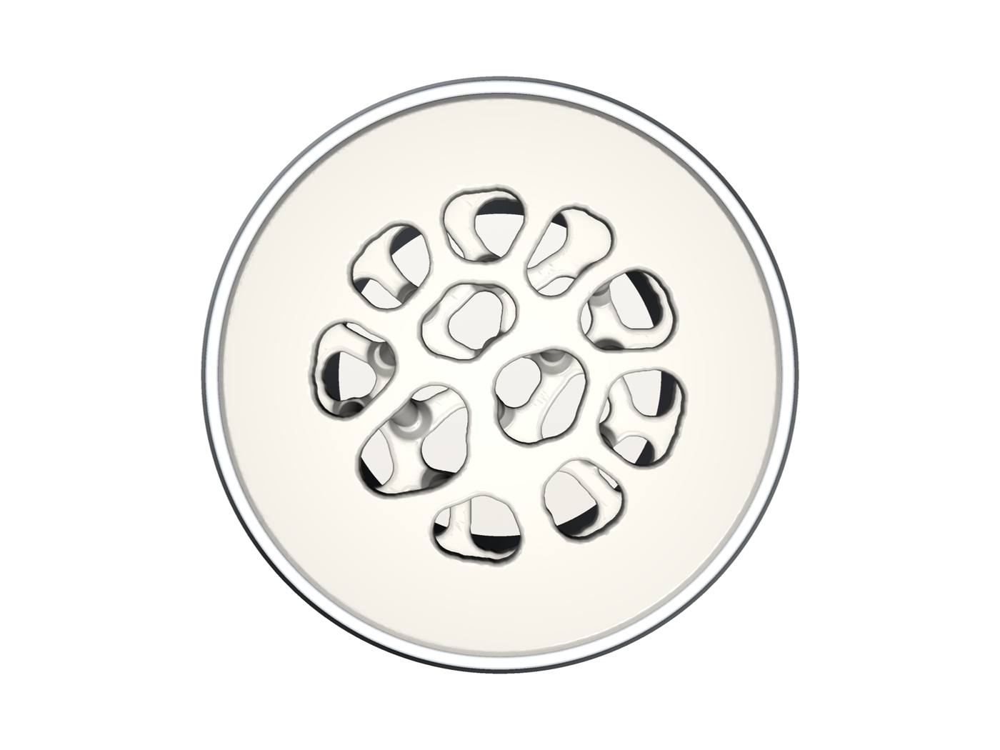 | 0 | — |
