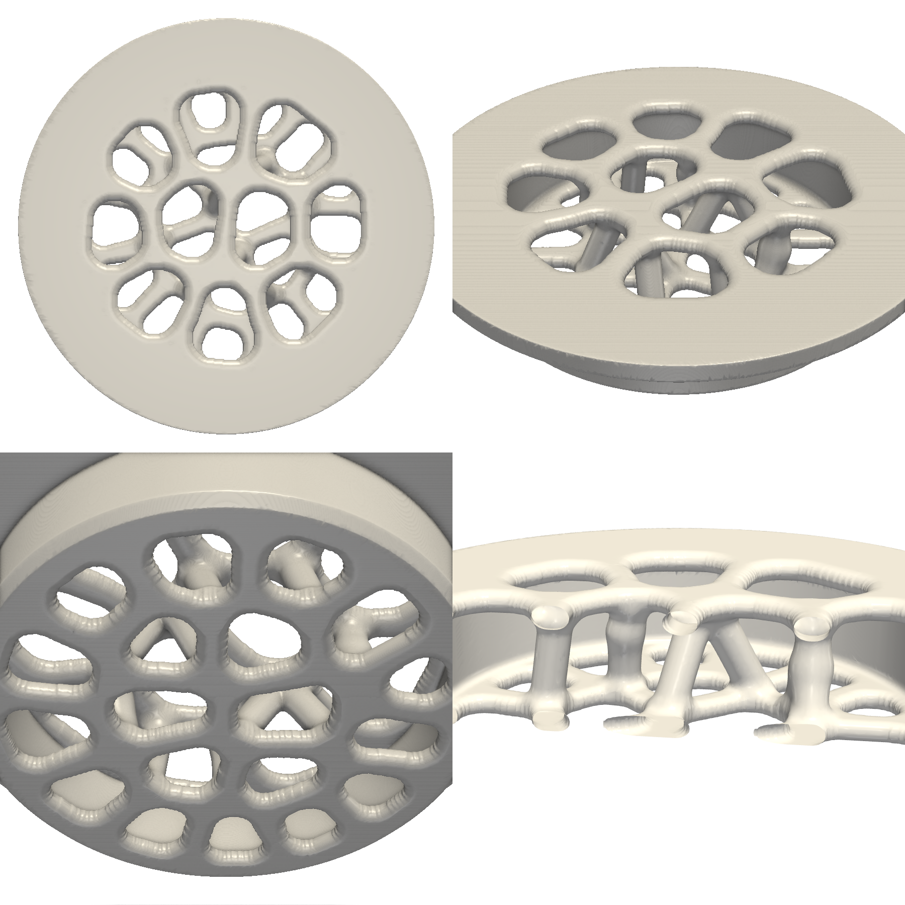

# Pebble field scripts (C, D, original E)

Archived generator for designs pebble-c and pebble-d. Metrics and previews now live in `../../designs/pebble-c/` and `../../designs/pebble-d/`. Style D (default) vaults the fine layer so nothing is printed over air; style C is the released version. `build_plate.py` is the original pebble-e script, superseded by `model.py`.

## Version C

Original two-level Voronoi design for a washbasin drain, kept as a worked example in [gendesign](../../../../README.md). Big rounded pebble cells sit flush with the basin. Below them, the struts branch down into a finer layer of cells that catches hair. It is designed to print without supports on a Bambu A1 mini in PLA.

The scripts below run from this folder (`models/hair-catcher/archive/pebble-field/`). Dependencies are the repo-root `requirements.txt`.



## How it's generated

1. **Two cell layers.** Seed points for the top (spacing ≈ 8.2 mm) and the bottom (≈ 5.2 mm) are relaxed with Lloyd's algorithm. They're also mirrored across the bore wall, so the outer cells end at the wall instead of being cut off.
2. **Pebble openings.** Each Voronoi cell is inset by half a rib width. It's then morphologically opened with a disc, which gives every corner a radius of at least 2.3 mm (top) or 1.35 mm (bottom). The rims are rounded again in 3D with a smooth max. This avoids the faceted look of a plain Voronoi pattern.
3. **Branching struts.** Every junction in the bottom pattern is claimed by the nearest top junction it can reach within 30° of vertical. A top junction with several children grows a trunk that forks lower down, so the big cells grow into the small ones. Struts end exactly on rib junctions, so they don't block the openings.
4. **Signed distance field.** Ribs, struts, flange and collar are blended with smooth unions, which gives soft junctions and gusset-like flares. The outer envelope (flange and collar OD with its lead-in) is applied last, unblended, so the fit dimensions stay exact.
5. The field is meshed with marching cubes on a 0.08 mm grid, then cleaned and decimated. The print file is flipped so the flush top sits on the bed.

## Version C

| | Target | Measured |
|---|---|---|
| Top openings (inscribed Ø) | 5–8 mm, none < 4.5 | 10 openings, 5.4–7.0 mm, median 6.0 |
| Bottom openings (inscribed Ø) | 3.5–5.5 mm, none < 3.2 | 19 openings, 3.3–4.4 mm, median 3.95 |
| Ribs | ≥ 1.8 mm | min 1.98, typically 2.2–2.3 mm |
| Struts | 8–16, near vertical | 15 struts, Ø2.3 mm, max 28° from vertical |
| Mesh | watertight, one body | yes, 400k faces |

Openings are measured as the largest circle that fits through each hole. Equivalent-area diameters run about 1 mm larger. Full numbers are in [designs/pebble-c](../../designs/pebble-c/).

### Fit

| Feature | Size |
|---|---|
| Flange | Ø46.0 × 1.6 mm, flush with the basin |
| Collar | OD 35.21 mm CAD (≈ 35.10 after 0.3% PLA shrink), ID 32.0 mm, wall 1.6 mm, depth 7.0 mm, 0.7 mm 45° lead-in |
| Overall | 46 × 46 × 8.6 mm |

### Printing

- **Profile:** PLA, 0.20 mm layers, no supports, no brim.
- **Orientation:** `*_print.stl` is already flipped. The flush top and flange go on the bed, with the collar pointing up.
- **Estimate:** about 14 min plus printer startup, 4.8 g, 43 layers. This came from OrcaSlicer 2.5 with approximate A1 mini settings, so re-slice in Bambu Studio for an exact time.

Print STLs are on the [v0.3.0-C release](https://github.com/mayphus/gendesign/releases/tag/v0.3.0-C) (`hair_catcher_C_print.stl` is already flipped). Version C has not been test-printed.

## Run it

```bash
python -m venv .venv && .venv/bin/pip install -r ../../../../requirements.txt
.venv/bin/python search.py 100 150 8.2 5.2     # rank seeds against the targets
.venv/bin/python build.py 135 8.2 5.2 out/C 0.08 C  # build version C (≈ 1 min)
.venv/bin/python build.py 41 8.2 5.2 out/D 0.08 D   # build version D
.venv/bin/python render.py out/C               # preview images
```

`build.py` writes `installed.stl`, `print.stl`, `metrics.json` and `mesh.json`. Change the seed for a new pattern with the same constraints. Rib widths, corner radii and strut size are constants at the top of `build.py`, and the fit dimensions are in `design.py`.

## License

The code is released under the [MIT License](../../../../LICENSE). The generated models and images are released under [CC BY 4.0](https://creativecommons.org/licenses/by/4.0/).
